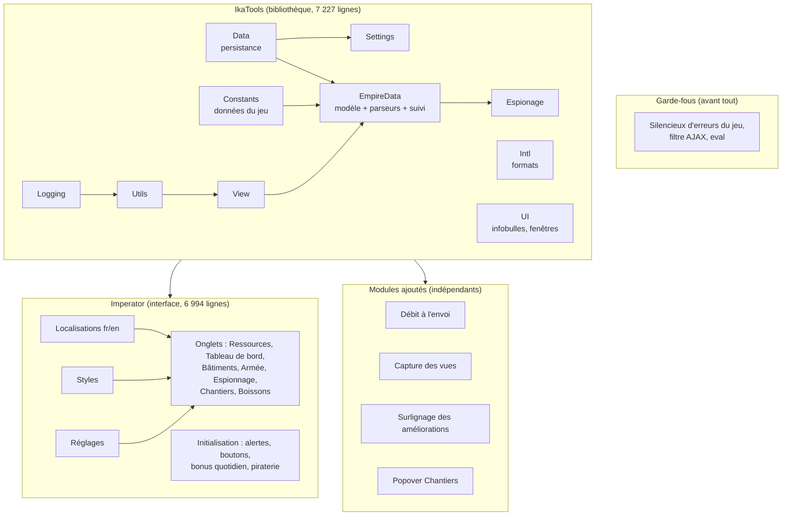

# Carte du script Imperator (v2.29)

Un seul fichier, `Imperator.user.js`, de **15 056 lignes**. Cette carte sert de plan pour
le découpage en modules. Elle a été établie par analyse de la syntaxe du fichier
(arbre syntaxique), pas par lecture des commentaires.

## Vue d'ensemble



## Les blocs, dans l'ordre du fichier

| Lignes | Taille | Bloc | Rôle | Dépend de |
|---|---:|---|---|---|
| 1-101 | 101 | En-tête `==UserScript==` | Métadonnées, `@history` | – |
| 102-197 | 96 | Popover Chantiers | Clic sur un niveau de bâtiment → « Planifier » | `window.Imperator…` |
| 201-363 | 163 | Garde-fous | Erreurs connues du jeu masquées, filtre AJAX sûr | – |
| 368-372 | 5 | `__impH` | Échappement HTML (v2.22) | – |
| 384-606 | 223 | IkaTools.Logging | Journal, options de débogage | Utils, Data |
| 611-886 | 276 | IkaTools.Utils | Requêtes, analyse des réponses AJAX du jeu | Logging, Constants |
| 892-1139 | 248 | IkaTools.Intl | Traduction, formats de nombres et de dates | Constants |
| 1141-1504 | 364 | IkaTools.View | Vue courante, navigation, abonnement aux réponses du jeu | Logging, Utils, EmpireData |
| 1511-1577 | 67 | IkaTools.Data | Sauvegarde (GM_setValue) avec versions | Logging, View |
| 1579-2119 | 541 | IkaTools.UI | Infobulles, fenêtres, onglets | Logging, Utils, Intl, Settings, Constants |
| 2121-2270 | 150 | IkaTools.Settings | Réglages typés (booléen, choix, texte, HTML) | Data |
| 2272-3210 | 939 | IkaTools.Constants | **Données du jeu** : bâtiments, unités, coûts, vues | – |
| 3212-4900 | 1 689 | EmpireData : modèle | Ville, Ressource, Bâtiment, Armée, Mouvement, Civilisation | Utils, View, Data, Constants |
| 4900-6250 | 1 351 | EmpireData : parseurs | Une fonction par vue du jeu (Troupes, Caserne, Hôtel de Ville, Bilan, Sanctuaire, Conseiller militaire…) | Utils, View, Constants |
| 6250-6855 | 606 | EmpireData : suivi | Branchement sur les réponses du jeu, rafraîchissements | Logging, Utils, View, Constants, Espionage |
| 6855-7525 | 671 | Espionage | Cibles, joueurs, alliances, rapports, combats | Utils, View, Data, Constants |
| 7607-7659 | 53 | Démarrage | Attente des données, extension de `String` | – |
| 7662-8148 | 487 | Imperator : localisations | Textes français et anglais | – |
| 8156-9261 | 1 106 | Imperator : styles | CSS de toutes les tables | – |
| 9263-9596 | 334 | Imperator : réglages | Options du script (dont Debug, Captures) | Settings, UI, EmpireData, Espionage |
| 9809-14011 | 4 203 | Imperator : onglets | Ressources (970), Tableau de bord (402), Bâtiments (330), Armée (428), Espionnage (446), Chantiers (160), Boissons (69), popups | presque tout IkaTools |
| 14046-14654 | 609 | Imperator : initialisation | Boutons rapides, alertes, retouches, piraterie, rafraîchissement | Utils, View, Constants, EmpireData |
| 14660-14751 | 92 | Débit à l'envoi | Ressources retirées dès l'envoi d'un transport | View, Constants, EmpireData |
| 14760-14961 | 202 | Capture des vues | Pages de référence pour le banc de test | Utils, View, Constants |
| 14965-15050 | 86 | Surlignage des améliorations | Bâtiments améliorables mis en évidence | Constants, EmpireData |

## Ce que la carte apprend

- **Un tiers du fichier est de la donnée, pas du code** : Constants (939 lignes),
  localisations (487) et styles (1 106). Ce sont les modules les plus simples à sortir.
- **Les modules ajoutés sont déjà indépendants** : chacun est une fonction autonome
  `(function install…() { … })()` qui n'utilise IkaTools que par son interface publique.
  Leur extraction ne change rien au comportement.
- **Le gros morceau est l'onglet Ressources** (970 lignes, dont une seule fonction
  `makeTableContent` de 858 lignes) : à découper en dernier, avec des tests.
- **Une dépendance circulaire** : View utilise EmpireData, qui utilise View. Elle ne gêne pas
  tant que tout reste dans IkaTools, mais elle fixe l'ordre d'assemblage.

## Le découpage proposé

```
src/
  00-entete.js            en-tête ==UserScript== (version, @history)
  01-popover-chantiers.js
  02-garde-fous.js
  10-ikatools/            Logging, Utils, Intl, View, Data, UI, Settings,
                          Constants, EmpireData (modèle, parseurs, suivi), Espionage
  20-imperator/           localisations, styles, réglages, un fichier par onglet, init
  30-modules/             debit-envoi, capture-vues, surlignage
outils/assembler.js       recolle src/ → Imperator.user.js
```

**Règle de sécurité** : chaque étape d'extraction est un simple déplacement de code.
`node outils/assembler.js` doit alors produire un `Imperator.user.js` **identique octet pour
octet** à celui d'avant. Si c'est le cas, le comportement ne peut pas avoir changé : pas
besoin de test en jeu pour ces étapes, et `npm test` reste vert.

Ordre prévu :
1. ✅ L'outil d'assemblage, plus l'en-tête et les trois modules ajoutés (identique octet pour octet,
   7 fichiers, fait le 7 nov. 2026).
2. ✅ Les données : Constants, localisations, styles (15 fichiers, identique octet pour octet,
   chaque fichier de données vérifié lisible seul).
3. ✅ Les blocs IkaTools, un par un (modèle, un parseur par vue, suivi, espionnage).
4. ✅ Les onglets d'Imperator, un fichier par onglet (40 fichiers en tout, identique octet
   pour octet).
5. ✅ Fichiers autonomes : 46 fichiers lisibles seuls + 9 enveloppes (ouverture/fermeture),
   IkaTools découpé en un fichier par module, carte des dépendances générée et vérifiée
   ([`DEPENDANCES.md`](DEPENDANCES.md)). Toujours identique octet pour octet.
6. ✅ Dépendances : 16 boucles → 0 (v2.38 à v2.41), règle des couches (base → modèle → façade →
   interface → modules) vérifiée à chaque test.
7. Ensuite, des améliorations dans les modules, prouvées par le banc d'affichage (7 onglets
   identiques) ou testées en jeu quand l'affichage change.
